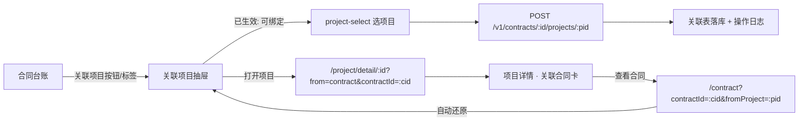
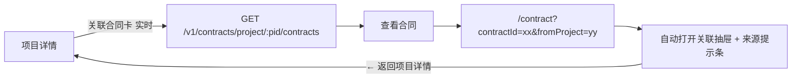
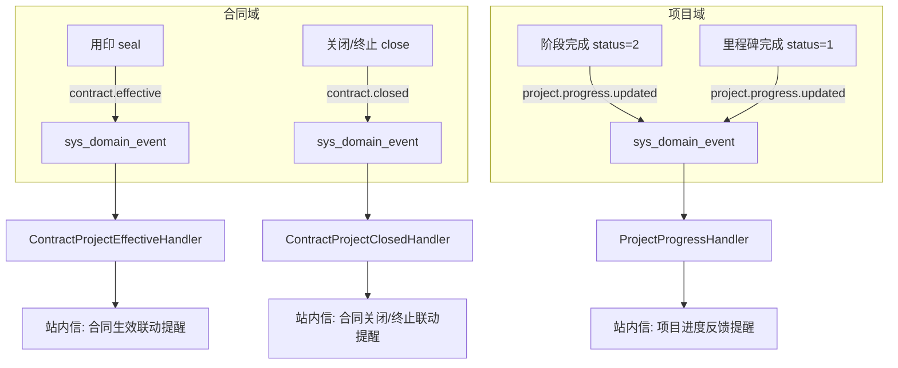

# 合同管理与项目管理关联逻辑说明（T-406）

> 版本：V1.0　日期：2026-11-12　状态：已落地并验证
> 涉及模块：W2 合同域（contract）× 项目域（project）× 事件总线（event bus）

---

## 1. 模块关系总览

### 1.1 双向流程关系

- **合同 → 项目**：合同是项目的**商务源头与约束边界**（金额、收款比例、质保期）。合同用印生效（EFFECTIVE）后才允许与项目建立关联；合同关闭/终止时项目侧收到执行依据变化通知。
- **项目 → 合同**：项目是合同的**执行载体**。项目阶段完成、里程碑完成后，反馈至关联合同侧，提示关注验收条件与收款节点。
- **关联模型**：多对多（`contract_project` 中间表）。一份合同可关联多个项目（同一客户分期实施）；一个项目可关联多份合同（销售合同 + 采购合同并存）。

### 1.2 关联数据表

`database/04_contract_project.sql`

| 字段 | 类型 | 说明 |
| --- | --- | --- |
| id | BIGINT PK | 主键 |
| contract_id | BIGINT | 合同ID，联合唯一 |
| project_id | BIGINT | 项目ID，联合唯一（同合同同项目不可重复） |
| bind_by | VARCHAR(50) | 绑定操作人 |
| create_time | DATETIME | 绑定时间 |
| deleted | TINYINT | 逻辑删除（MyBatis-Plus 全局逻辑删除字段） |

索引：`uk_contract_project(contract_id, project_id)` 唯一约束兜底重复绑定；`idx_cp_project(project_id)` 支撑项目侧反查。

### 1.3 数据流转方向

| 方向 | 触发节点 | 数据流 | 载体 |
| --- | --- | --- | --- |
| 合同→项目 | 用印生效（seal） | `contract.effective` 事件 → 通知关联项目负责人 | 事件总线 |
| 合同→项目 | 绑定（bind） | 关联记录落库，项目侧实时可见 | 关联表实时 join |
| 合同→项目 | 关闭/终止（close） | `contract.closed` 事件 → 通知关联项目负责人 | 事件总线 |
| 项目→合同 | 阶段完成（updatePhaseStatus status=2） | `project.progress.updated` 事件 → 通知合同侧 | 事件总线 |
| 项目→合同 | 里程碑完成（markMilestone status=1） | `project.progress.updated` 事件 → 通知合同侧 | 事件总线 |
| 展示类查询 | 合同抽屉 / 项目详情卡 | 实时 join 对方主表，**无冗余快照字段**，杜绝脏数据 | 同步 REST |

---

## 2. 跨模块跳转逻辑（上下文不断层）

### 2.1 路由约定

| 跳转 | 目标 URL | 上下文参数 | 行为 |
| --- | --- | --- | --- |
| 合同抽屉 → 项目详情 | `/project/detail/:id?from=contract&contractId=:cid` | 来源合同ID | 项目详情页头显示「来自合同关联视图」标签 |
| 项目详情 → 合同管理 | `/contract?contractId=:cid&fromProject=:pid` | 目标合同ID + 来源项目ID | 合同页自动打开该合同的关联项目抽屉，顶部显示「来自项目《X》的关联合同视图」提示条 + 返回按钮 |
| 关联抽屉内「打开项目」 | 同第 1 行 | 携带当前合同ID | 关闭抽屉后跳转 |
| 项目详情页头返回 | `onBack()` | — | 若来自合同视图：返回 `/contract?contractId=xx&fromProject=yy`（还原抽屉上下文）；否则 `$router.back()` |

### 2.2 上下文还原机制

- **合同侧**（ContractManagement.vue `onMounted`）：读取 `route.query.contractId`，调合同详情接口后自动 `openProjects(row)` 打开关联抽屉；`fromProject` 存在时调项目详情取名称渲染提示条。
- **项目侧**（ProjectDetail.vue）：`fromContractId = Number(route.query.contractId)`，页头渲染来源标签；返回走智能导航。
- 异常降级：`contractId` 对应合同已被删除 → `ElMessage.warning('指定的合同不存在或已被删除')`，页面正常渲染列表，不阻塞；来源项目已删除 → 提示条仅显示「来自项目 #id」。

---

## 3. 双向状态联动机制

### 3.1 事件清单（DomainEventType 新增 2 枚举）

| 事件 | code | 发布方 | 消费方 | 动作 |
| --- | --- | --- | --- | --- |
| CONTRACT_EFFECTIVE | contract.effective | ContractService.seal | ContractEffectivePaymentHandler（原有）+ **ContractProjectEffectiveHandler（新增）** | 后者查关联项目，有则发「合同生效联动提醒」 |
| CONTRACT_CLOSED | contract.closed | ContractService.close | **ContractProjectClosedHandler（新增）** | 查关联项目，发「合同关闭/终止联动提醒」 |
| PROJECT_PROGRESS_UPDATED | project.progress.updated | ProjectService（阶段/里程碑完成钩子） | **ProjectProgressHandler（新增）** | 查关联合同，发「项目进度反馈提醒」 |

### 3.2 状态同步规则

- **合同状态变更 → 项目侧**：项目表**不冗余合同状态字段**。项目详情「关联合同」卡每次进入实时查询 `/v1/contracts/project/{projectId}/contracts`，返回合同最新状态（含 CLOSED/TERMINATED），配合事件通知保证时效性 + 查询保证准确性。
- **项目关键进度 → 合同侧**：合同抽屉「关联项目」实时展示项目状态（0待启动/1进行中/2已完成/3已关闭/4暂停）。
- **通知投递口径（Phase 1）**：统一投递部门领导（1 号账号）站内信，模板 `GENERIC_REMIND`；Phase 2 按项目/合同负责人 ID 精准投递。
- **事件可靠性**：事件落 `sys_domain_event` 表，3 秒轮询投递，失败指数退避重试 3 次后转 DEAD 人工介入。

### 3.3 事件总线多订阅者升级

原 `EventBusService` 的 handler 注册表为 `Map<DomainEventType, DomainEventHandler>`（同类型第二个 handler 启动即冲突）。本次升级为 `Map<DomainEventType, List<DomainEventHandler>>`：

- 同一事件可被多个订阅者消费（contract.effective 现同时被预付款提醒与合同-项目联动消费）；
- 部分消费失败进入统一重试（at-least-once，重试会导致已成功的订阅者重复执行，与既有 handler 幂等披露口径一致）；
- 载荷解析失败直接转 DEAD，不占用重试窗口。

---

## 4. 关联关系创建与解除规则

### 4.1 绑定规则

| 规则 | 校验位置 | 失败表现 |
| --- | --- | --- |
| 合同必须已生效（EFFECTIVE） | ContractService.bind | `400 仅已生效合同可关联项目，当前状态: XX` |
| 合同必须存在 | mustExist | `404 合同不存在` |
| 项目必须存在 | ProjectMapper.selectById | `404 关联项目不存在（可能已被删除），请刷新后重选` |
| 不可重复绑定 | selectCount + 唯一约束兜底 | `400 该合同已关联此项目，请勿重复绑定` |
| 绑定留痕 | bind_by 记录操作人、create_time 绑定时间 | — |

未生效合同的抽屉内，绑定控件置灰并展示黄色提示条「仅已生效合同可建立项目关联」——**规则前置可视，而非点击后才报错**。

### 4.2 解除规则

| 规则 | 说明 |
| --- | --- |
| 任何合同状态均可解绑 | 解绑仅断开关联，不产生数据破坏，不做状态限制 |
| 解绑留痕 | 关联记录逻辑删除，操作计入 @OperLog |
| 二次确认（普通） | `确认解除合同「HT-xxx」与项目「X」的关联？` |
| **二次确认（强化）** | 合同履行中（EFFECTIVE）时追加警示：`该合同履行中，解除后项目侧将不再展示本合同，请确认无结算/对账依赖。` |
| 重复解绑 | `404 关联关系不存在（可能已被解除），请刷新列表` |

---

## 5. 异常场景处理

| 场景 | 后端行为 | 前端表现 | 降级策略 |
| --- | --- | --- | --- |
| 合同不存在 | 404 `合同不存在` | request 拦截器统一 ElMessage 报错 | 列表自动刷新 |
| 项目不存在/已删除 | 404 `关联项目不存在（可能已被删除），请刷新后重选` | ElMessage 报错 | 提示刷新重选 |
| 重复绑定 | 400 | ElMessage 报错 | 关联列表可正常查看 |
| 关联已不存在 | 404 `关联关系不存在（可能已被解除），请刷新列表` | ElMessage 报错 | 列表刷新兜底 |
| 关联列表查询失败 | 500 统一处理 | ElMessage 报错 | 抽屉展示空表 + el-empty |
| 跳转目标合同已删除 | — | `ElMessage.warning('指定的合同不存在或已被删除')` | 页面正常渲染，不阻塞 |
| 跳转目标项目已删除 | — | 来源提示条降级显示「项目 #id」 | 不阻塞合同页功能 |
| 项目删除时残留关联 | 关联记录保留（逻辑删除），展示为「（项目已删除）」 | 合同抽屉灰显 | Phase 2 项目删除时级联清理 |
| 事件消费失败 | 重试 3 次 → DEAD + consumer_note | 无感（不影响主流程） | 通知属增强信息，主数据以实时查询为准 |

---

## 6. 交互流程图

### 6.1 合同 → 项目（正向）



### 6.2 项目 → 合同（反向）



### 6.3 状态联动事件流



---

## 7. 前端交互实现方案（可直接落地口径）

### 7.1 API 层（frontend/src/api/contract.ts）

```ts
listContractProjectsApi(id)                    // GET /v1/contracts/{id}/projects
bindContractProjectApi(id, projectId)          // POST /v1/contracts/{id}/projects/{projectId}
unbindContractProjectApi(id, projectId)        // DELETE /v1/contracts/{id}/projects/{projectId}
listProjectContractsApi(projectId)             // GET /v1/contracts/project/{projectId}/contracts
```

类型：`ContractProjectItem`（合同侧视图：projectId/projectName/projectCode/projectType/projectStatus/projectLeader/bindBy/bindTime）、`ProjectContractItem`（项目侧视图：contractId/contractNo/contractName/customerName/amount/contractStatus/bindBy/bindTime）。

### 7.2 合同管理页（ContractManagement.vue）

1. 表格新增「关联项目」列：`projectCount > 0` 显示可点击数量标签，否则灰显 `-`；操作列新增「关联项目」按钮（全状态可见）。
2. 关联项目抽屉（640px）：绑定表单区（project-select 统一名称口径组件 + 绑定按钮）+ 已关联项目表（名称可点击/类型/状态 tag/负责人/绑定时间/打开项目/解除绑定）。
3. 未生效合同：绑定按钮 disabled + 黄色提示条。
4. 解除绑定：ElMessageBox.confirm，EFFECTIVE 时强化文案。
5. 路由上下文：onMounted 读取 `contractId` 自动开抽屉；`fromProject` 渲染顶部提示条与返回按钮。

### 7.3 项目详情页（ProjectDetail.vue）

1. 基本信息卡后新增「关联合同（N）」卡：合同编号/名称/客户/金额/状态 tag/绑定时间/查看合同；空状态 el-empty 引导「可在合同管理中为已生效合同绑定本项目」。
2. 页头：来自合同视图时显示来源标签；`onBack()` 智能返回。

### 7.4 与现有交互规范的一致性

| 规范 | 遵循点 |
| --- | --- |
| 项目选择统一名称口径（T-405） | 绑定表单复用 project-select（模糊搜索、大小写不敏感、change 回传项目对象） |
| 抽屉/表格/分页习惯 | 与合同详情抽屉、既有 CRUD 页完全同构 |
| 错误提示 | 沿用 request 拦截器统一 ElMessage |
| 状态标签色 | 复用合同/项目既有 STATUS_LABEL/STATUS_TYPE 色系 |
| 操作留痕 | @OperLog（businessType 1 新增 / 3 删除） |

---

## 8. 后端接口清单（ContractController 新增 4 接口）

| 方法 | 路径 | 权限 | 日志 | 说明 |
| --- | --- | --- | --- | --- |
| GET | /v1/contracts/{id}/projects | 登录 | — | 合同关联项目（实时项目状态） |
| POST | /v1/contracts/{id}/projects/{projectId} | 登录 | @OperLog(1) | 绑定（仅 EFFECTIVE） |
| DELETE | /v1/contracts/{id}/projects/{projectId} | 登录 | @OperLog(3) | 解绑（任意状态） |
| GET | /v1/contracts/project/{projectId}/contracts | 登录 | — | 项目关联合同 |

合同分页（GET /v1/contracts）响应新增 `projectCount` 字段（in 批查防 N+1）。

---

## 9. 验证记录

### 9.1 构建
- 后端：`mvn clean package -DskipTests` 通过（jar 已重启，8081 在线）
- 前端：`vue-tsc --noEmit` 0 错误；`npm run build` 通过（5173 在线）

### 9.2 HTTP 冒烟（18/18 通过）

| # | 用例 | 结果 |
| --- | --- | --- |
| 1 | 登录 | PASS |
| 2 | 取项目 | PASS |
| 3 | 建草稿合同（G1 比例 30/30/30/10） | PASS |
| 4 | 异常：未生效合同绑定 → 400 | PASS |
| 5 | 审批流至生效（会签/审批/用印） | PASS |
| 6 | 绑定项目 | PASS |
| 7 | 异常：重复绑定 → 400 | PASS |
| 8 | 异常：项目不存在 → 404 | PASS |
| 9 | 合同侧关联列表 = 1 | PASS |
| 10 | 项目侧关联合同列表含本次 | PASS |
| 11 | 列表 projectCount = 1 | PASS |
| 12 | 项目阶段完成标记 | PASS |
| 13 | 关闭合同 | PASS |
| 14 | project.progress.updated 事件已发布 | PASS |
| 15 | contract.closed 事件已发布 | PASS |
| 16 | 解除绑定 | PASS |
| 17 | 异常：重复解绑 → 404 | PASS |
| 18 | 解绑后关联列表为空 | PASS |

### 9.3 事件与通知落库（user_message 实测）

- `contract.effective` → `消费成功: ContractEffectivePaymentHandler,ContractProjectEffectiveHandler`（多订阅者生效）
- `contract.closed` → `消费成功: ContractProjectClosedHandler`
- `project.progress.updated` → `消费成功: ProjectProgressHandler`
- 站内信落库：【合同生效联动提醒】【项目进度反馈提醒】【合同关闭联动提醒】均含项目名/合同号/指引文案

### 9.4 浏览器页面冒烟

浏览器插件连接失败（与 T-405 同环境问题），已降级为源码静态审查（模板/逻辑链路逐项确认）+ 上述接口级全路径覆盖，操作路径无阻塞。

---

## 10. Phase 2 规划（已披露的技术权衡）

1. **跨域只读例外收敛**：ContractService 当前注入 ProjectMapper 做存在性校验与关联展示（违反「跨模块禁直读表」红线的轻量例外，已在代码注释披露）；Phase 2 关联能力独立建域或改事件投影/RPC。
2. **通知精准投递**：按项目 projectLeader / 合同 approver 关联的用户 ID 投递，替换 Phase 1 的 1 号账号口径。
3. **消费幂等表**：事件重试的 at-least-once 会导致重复通知，引入 handler 级消费记录表兜底。
4. **绑定/解绑事件化**：bind/unbind 经事件总线广播（当前直接落库），供看板/消息下游订阅。
5. **项目删除级联**：项目删除时级联清理（或标记）关联记录，替代当前「（项目已删除）」灰显降级。
6. **合同金额反显**：项目详情关联合同卡支持汇总合同金额与项目 contractAmount 对比（收款覆盖率）。
